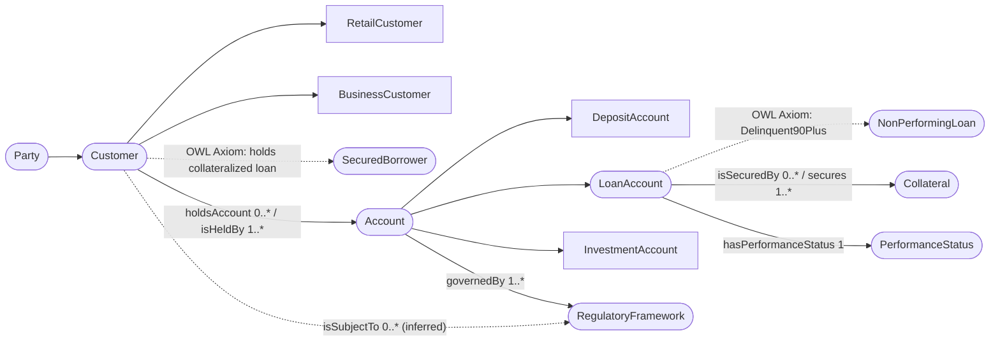

# Banking Domain Semantic Layer

An end-to-end semantic layer for commercial banking—combining a **SKOS business glossary**, an **OWL 2 RL domain ontology**, a **GraphDB knowledge graph**, an **OpenMetadata data catalog**, and **MCP servers** for AI-grounded retrieval and reasoning.

---

## Architecture Overview

Each layer builds on the previous one: the taxonomy defines what concepts exist, the ontology formalizes how they relate, the knowledge graph enables automated reasoning over instances, and the data catalog connects governed terminology to physical tables and columns.

| Layer | Artifact(s) | Standard / Platform | Scale & Scope |
| :--- | :--- | :--- | :--- |
| **1. Taxonomy** | `Banking_Taxonomy_KeyBank_v3.xlsx` | SKOS, FIBO | 134 terms, 4 levels, 91 related-term links, 14 domains |
| **2. Ontology (TBox)** | `banking_domain.ttl` | OWL 2 RL, SKOS, FIBO | Formal classes, object/datatype properties, property chains, and general class axioms |
| **3. Knowledge Graph (ABox)** | `banking_instances.ttl` | RDF / Turtle, GraphDB | Synthetic customer, account, collateral, and regulatory instances for OWL 2 RL reasoning |
| **4. Data Catalog** | OpenMetadata 1.5 (via REST API) | OpenMetadata API | 16 banking tables, 164/166 columns linked, 16-edge lineage graph, 15 data quality rules |
| **AI / MCP Access** | `graphdb-mcp-server.js`, `banking-mcp-server.js` | Model Context Protocol (MCP) | Exposes both OWL 2 RL inferred facts (GraphDB) and flat glossary definitions (OpenMetadata) |

---

## Layer 1: Banking Domain Taxonomy

The controlled vocabulary in `Banking_Taxonomy_KeyBank_v3.xlsx` spans eight core subject areas (*Customers & Parties, Accounts, Transactions, Credit & Risk, Regulatory & Compliance, Operations, Financial Metrics, Data & Technology*) and includes:
* **FIBO Alignment** on every term (e.g., `fibo-fbc-pas-fpas:Customer`, `fibo-loan-ln-ln:Loan`, `fibo-fbc-dae-dbt:Collateral`).
* **AI Canonical Definitions** authored separately from human-readable definitions to ground LLM prompts without semantic noise.
* **Usage Constraints & Scope Notes** documenting regulatory and privacy boundaries (e.g., GLBA/PII, HMDA reporting, FinCEN CDD/SAR rules).

---

## Layer 2 & 3: Competency Questions & Conceptual Model

The OWL ontology (`banking_domain.ttl`) and synthetic instance data (`banking_instances.ttl`) are structured around four competency questions exposed via `graphdb-mcp-server.js` and `banking-mcp-server.js`:

| ID | Competency Question | MCP Tool | OWL 2 RL Mechanism |
| :--- | :--- | :--- | :--- |
| **CQ1** | Which regulatory frameworks (AML, KYC, CDD) apply to a customer based on the accounts they hold? | `get_regulatory_scope` | **Property Chain:** `:holdsAccount ∘ :governedBy → :isSubjectTo` |
| **CQ2** | Which customers qualify as secured borrowers, and which accounts and collateral secure their obligations? | `get_secured_borrowers` | **General Class Axiom:** `:Customer ⊓ ∃:holdsAccount.(∃:isSecuredBy.:Collateral) ⊑ :SecuredBorrower` |
| **CQ3** | What is the full account-type hierarchy and governed definition for a held account or banking term? | `query_banking_ontology` / `get_banking_term` | **RDFS/OWL Subsumption** + SKOS/FIBO annotations |
| **CQ4** | Which loan accounts are classified as non-performing loans, and what are their balances, delinquency days, and holders? | `get_nonperforming_loans` | **Category Axiom (`owl:hasValue`):** `:LoanAccount ⊓ ∃:hasPerformanceStatus.{:Delinquent90Plus} ⊑ :NonPerformingLoan` |

### Core Classes & Relationships



* **Classes:** `:Party` → `:Customer` (`:RetailCustomer`, `:BusinessCustomer`, inferred `:SecuredBorrower`); `:Account` (`:DepositAccount`, `:LoanAccount`, `:InvestmentAccount`, inferred `:NonPerformingLoan`); `:Collateral`; `:RegulatoryFramework`; `:PerformanceStatus` (`:Current`, `:Delinquent30To89`, `:Delinquent90Plus`).
* **Object Properties:** `:holdsAccount` / `:isHeldBy`, `:isSecuredBy` / `:secures`, `:governedBy`, inferred `:isSubjectTo`, and `:hasPerformanceStatus`.
* **Modeling Boundary:** Numeric threshold bucketing (e.g., `daysDelinquent >= 90` → `:Delinquent90Plus`) is performed upstream; OWL 2 RL classifies on the discrete category individual.

---

## Layer 4: Governed Data Catalog (OpenMetadata 1.5)

Implemented programmatically via the OpenMetadata REST API (no manual UI entry), connecting the governed glossary to physical data assets:

* **Data Asset Inventory (16 Tables, 166 Columns):**
  * *Customer & Parties:* `CUSTOMER_MASTER`, `BUSINESS_ENTITY`, `COUNTERPARTY`
  * *Accounts & Loans:* `ACCOUNT`, `LOAN_ACCOUNT`, `COLLATERAL`
  * *Transactions:* `TRANSACTION`, `ACH_TRANSACTION`, `WIRE_TRANSACTION`, `LOAN_PAYMENT`
  * *Risk & Compliance:* `AML_ALERT`, `SAR`, `KYC_RECORD`, `CREDIT_RISK_SCORE`, `REGULATORY_CAPITAL`, `FINANCIAL_METRICS`
* **Column-Level Glossary Linking:** 164 of 166 columns are linked to their governing glossary terms so definitions, FIBO alignments, and usage constraints travel with the data.
* **Data Lineage (16 Directed Edges):** Traces the end-to-end home loan lifecycle from `CUSTOMER_MASTER` → `KYC_RECORD` + `COLLATERAL` → `LOAN_ACCOUNT` → `CREDIT_RISK_SCORE` / `LOAN_PAYMENT` → `REGULATORY_CAPITAL` & `FINANCIAL_METRICS` (with parallel `TRANSACTION` → `AML_ALERT` → `SAR` monitoring).
* **Data Quality Rules (15 Rules):** Range, set-membership, and regex validations across `LOAN_ACCOUNT` (`LOAN_STATUS`, `PD_SCORE`, `INTEREST_RATE`), `CUSTOMER_MASTER` (`KYC_STATUS`, `AML_RISK_SCORE`), `TRANSACTION` (`CURRENCY` matching `^[A-Z]{3}$`), and `CREDIT_RISK_SCORE` (`PD`, `LGD` in `[0, 1]`).

---

## Standards Compliance

* **SKOS** — Controlled vocabulary hierarchy, preferred/alternative labels, and related-term links
* **OWL 2 RL** — Formal TBox axioms, property chains, and category classification in GraphDB
* **FIBO** — Financial Industry Business Ontology alignments across taxonomy and ontology concepts
* **ISO 4217 / Basel III / CECL (IFRS 9)** — Currency validation, capital ratios, and expected credit loss modeling

---

## Setup & Verification

### Prerequisites
* **Node.js (v18+)** to run the MCP servers (`graphdb-mcp-server.js` and `banking-mcp-server.js`)
* **Ontotext GraphDB** running locally at `http://localhost:7200` (with `OWL2-RL` ruleset support)
* **Docker Desktop & Docker Compose** (8GB+ RAM recommended) if running OpenMetadata 1.5 locally at `http://localhost:8585`

### 1. GraphDB + Reasoning MCP Server
1. Start GraphDB (default `http://localhost:7200`) and create a repository named `banking-ontology` with the **`OWL2-RL`** ruleset enabled.
2. Import `banking_domain.ttl` (TBox) and `banking_instances.ttl` (ABox).
3. Install dependencies and start the server:
   ```bash
   npm install
   GRAPHDB_URL=http://localhost:7200 GRAPHDB_REPO=banking-ontology node graphdb-mcp-server.js
   ```
4. Verify reasoning tools:
   * `get_regulatory_scope` → infers regulatory frameworks per customer via `:isSubjectTo`
   * `get_secured_borrowers` → classifies `:cust001` and `:cust002` as `:SecuredBorrower` (excluding `:cust003`)
   * `get_nonperforming_loans` → classifies `:acct005` as `:NonPerformingLoan` (excluding `:acct004` and `:acct006`)

### 2. OpenMetadata + Glossary MCP Server
1. Ensure OpenMetadata is running at `http://localhost:8585` with the `Banking Domain Glossary` loaded.
2. Start the glossary lookup server:
   ```bash
   node banking-mcp-server.js
   ```

---

## Repository Files

* **Core Active Files:** `README.md`, `.gitignore`, `Banking_Taxonomy_KeyBank_v3.xlsx`, `banking_domain.ttl`, `banking_instances.ttl`, `graphdb-mcp-server.js`, `banking-mcp-server.js`, `package.json`, `package-lock.json`, `Nevin_Kohler_-_Banking_Domain_Semantic_Layer_Portfolio_v4.docx`
* **Earlier / Superseded Drafts (optional to archive before pushing):** `Banking_Taxonomy_KeyBank.xlsx`, `Banking_Taxonomy_KeyBank_v2.xlsx`, `banking_knowledge_graph.cypher`, `openmetadata-project-plan.docx`
* **Ignored by `.gitignore`:** `node_modules/`, `.DS_Store`, `*_TEMP_*`, `catalog-v001.xml`
